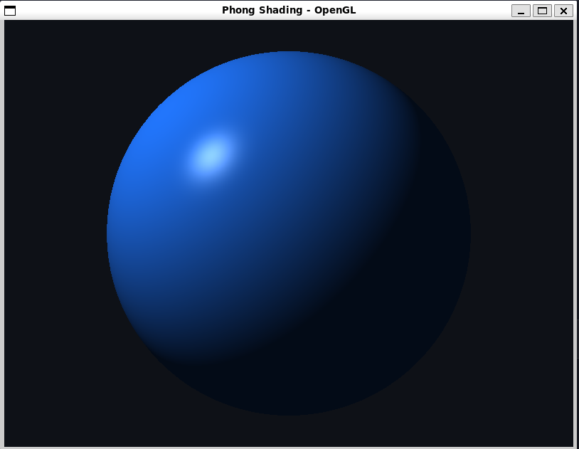
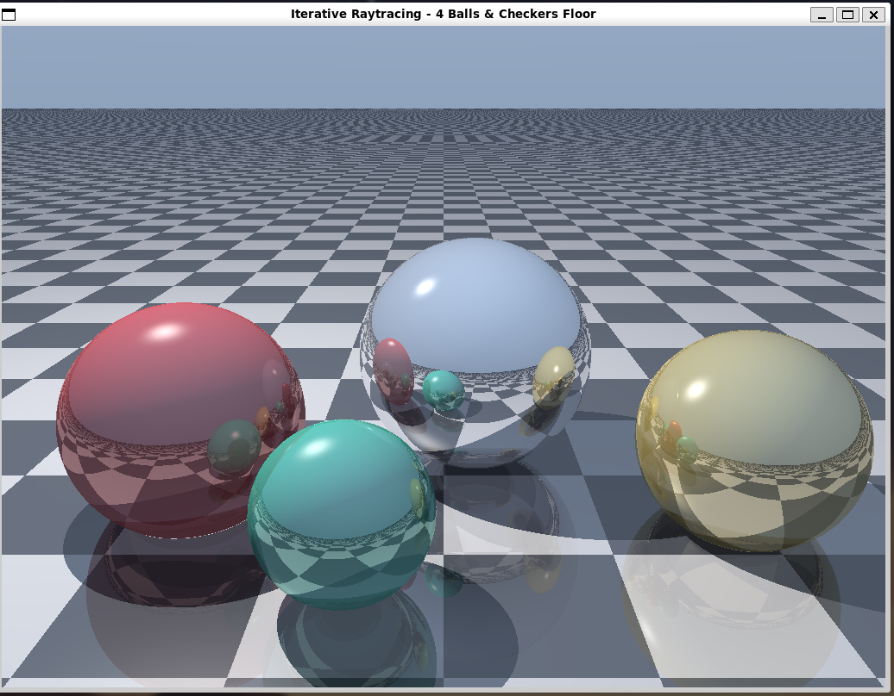

# Iterative Raytracing with Checkered Floor & 4 Balls

A real-time iterative raytracer implemented in C++ using **SDL3**, **OpenGL 3.3 Core**, and **GLAD**.

## Demos

| Demo 1 | Demo 2 |
| :---: | :---: |
|  |  |


---

## Features

- **4 Distinct Reflective Spheres (Balls)**:
  - **Mirror / Chrome Ball**: High reflectivity ($0.85$), reflecting the surrounding scene, other balls, sky, and floor.
  - **Ruby Red Ball**: Vibrant diffuse color with glossy specular reflection.
  - **Gold / Brass Ball**: Metallic golden sphere with warm specular highlights.
  - **Emerald / Cyan Ball**: Shiny gemstone-like reflective sphere in the foreground.
- **Checkered Floor**:
  - Infinite procedural 3D checkerboard plane at $y = -1.0$.
  - Features glossy reflection of the spheres, sky, and light.
- **Single Light Source & Dynamic Shadows**:
  - A single point light source orbits overhead.
  - Computes shadow rays to test direct line-of-sight from surface hit points to the light source, producing hard shadows across both the balls and the checkered floor.
- **Iterative Raytracing (No Recursion)**:
  - Supports up to 5 reflection bounces using an iterative loop (`for (int bounce = 0; bounce < MAX_BOUNCES; ++bounce)`).
  - Uses energy throughput tracking (`throughput *= reflectivity * albedo`) to prevent recursion while maintaining physically grounded light transport.
- **Interactive Controls**:
  - **Left Click + Drag**: Orbit the camera $360^\circ$ around the scene.
  - **Spacebar**: Toggle / pause animation.
  - **Escape**: Exit the application.
  - **Window Resize**: Dynamically recalculates ray directions and aspect ratio.

---

## Build & Run Instructions

### 1. Windows (Visual Studio / CMake)

Ensure CMake and Visual Studio are installed:

```powershell
# Configure and build Release executable
cmake -B build
cmake --build build --config Release

# Run the application
.\build\Release\phong.exe
```

> **Note regarding Windows 11 Smart App Control:**
> If you encounter `An Application Control policy has blocked this file`, disable Smart App Control in **Windows Security > App & browser control > Smart App Control settings**, or launch and debug the executable through Visual Studio.

---

### 2. Linux / WSL (WSLg)

WSLg on Windows 11 natively supports hardware-accelerated GUI output.

```bash
# 1. Install dependencies
sudo apt update
sudo apt install -y build-essential cmake pkg-config libgl1-mesa-dev libsdl3-dev

# 2. Configure and build
cmake -B build-linux
cmake --build build-linux

# 3. Run
./build-linux/phong
```

---

## Project Structure

```text
├── CMakeLists.txt         # Cross-platform CMake configuration
├── DEMO1.png              # Application screenshot 1
├── DEMO2.png              # Application screenshot 2
├── README.md              # Project documentation
├── phong.cpp              # Full raytracer application & GLSL shaders
├── glad/                  # OpenGL 3.3 Core GLAD loader
│   ├── include/
│   │   ├── KHR/
│   │   └── glad/
│   └── src/
└── SDL3-3.4.0/            # Bundled SDL3 development package (Windows)
```

---

## Source Codes

### 1. `CMakeLists.txt`

```cmake
cmake_minimum_required(VERSION 3.20)
project(PhongDemo C CXX)

set(CMAKE_CXX_STANDARD 17)
set(CMAKE_CXX_STANDARD_REQUIRED ON)

if(WIN32)
    # Architecture hint for the bundled Windows SDL3 package
    if(NOT DEFINED SDL_CPU_X64 AND NOT DEFINED SDL_CPU_X86 AND NOT DEFINED SDL_CPU_ARM64)
        if(CMAKE_SIZEOF_VOID_P EQUAL 8)
            set(SDL_CPU_X64 1)
        else()
            set(SDL_CPU_X86 1)
        endif()
    endif()

    list(PREPEND CMAKE_PREFIX_PATH "${CMAKE_CURRENT_SOURCE_DIR}/SDL3-3.4.0")
    find_package(SDL3 REQUIRED CONFIG)
else()
    # 1. Check if SDL3 source is present locally in a folder
    if(EXISTS "${CMAKE_CURRENT_SOURCE_DIR}/SDL3-linux/CMakeLists.txt")
        add_subdirectory(SDL3-linux)
    elseif(EXISTS "${CMAKE_CURRENT_SOURCE_DIR}/SDL3/CMakeLists.txt")
        add_subdirectory(SDL3)
    else()
        # 2. Look for system SDL3
        find_package(SDL3 CONFIG QUIET)
        if(NOT SDL3_FOUND)
            find_package(PkgConfig QUIET)
            if(PkgConfig_FOUND)
                pkg_check_modules(SDL3 QUIET IMPORTED_TARGET sdl3)
                if(TARGET PkgConfig::SDL3)
                    add_library(SDL3::SDL3 ALIAS PkgConfig::SDL3)
                    set(SDL3_FOUND TRUE)
                endif()
            endif()
        endif()

        # 3. Fallback to FetchContent if not found
        if(NOT SDL3_FOUND AND NOT TARGET SDL3::SDL3)
            message(STATUS "SDL3 not found on system or local folder. Fetching SDL3 via FetchContent...")
            include(FetchContent)
            FetchContent_Declare(
                SDL3
                GIT_REPOSITORY https://github.com/libsdl-org/SDL.git
                GIT_TAG release-3.2.8
                GIT_SHALLOW TRUE
            )
            FetchContent_MakeAvailable(SDL3)
        endif()
    endif()
endif()

# OpenGL
find_package(OpenGL REQUIRED)

# GLAD OpenGL loader library
add_library(glad STATIC
    glad/src/gl.c
)
target_include_directories(glad PUBLIC
    ${CMAKE_CURRENT_SOURCE_DIR}/glad/include
)

# Main executable
add_executable(phong
    phong.cpp
)

target_link_libraries(phong PRIVATE
    glad
    SDL3::SDL3
    OpenGL::GL
)

# On Windows: copy SDL3.dll next to the executable
if(WIN32 AND TARGET SDL3::SDL3-shared)
    add_custom_command(TARGET phong POST_BUILD
        COMMAND ${CMAKE_COMMAND} -E copy_if_different
            $<TARGET_FILE:SDL3::SDL3-shared>
            $<TARGET_FILE_DIR:phong>
        COMMENT "Copying SDL3.dll to executable directory..."
        VERBATIM
    )
endif()
```

---

### 2. `phong.cpp`

```cpp
// phong.cpp - Real-time iterative raytracer using SDL3 + OpenGL 3.3 + GLAD.
// Features: 4 reflective spheres, checkered floor, single light source, shadow rays,
// and iterative ray-bouncing (reflections).

#include <SDL3/SDL.h>
#include <glad/glad.h>

#include <algorithm>
#include <cmath>
#include <cstddef>
#include <iostream>
#include <vector>

namespace {

// Fullscreen quad vertex shader
constexpr const char* VERTEX_SHADER = R"GLSL(
#version 330 core
layout (location = 0) in vec2 aPos;
out vec2 vUV;

void main() {
    vUV = aPos * 0.5 + 0.5; // Map from [-1, 1] to [0, 1]
    gl_Position = vec4(aPos, 0.0, 1.0);
}
)GLSL";

// Iterative ray tracing fragment shader
constexpr const char* FRAGMENT_SHADER = R"GLSL(
#version 330 core
in vec2 vUV;
out vec4 FragColor;

uniform vec2  uResolution;
uniform float uTime;
uniform vec3  uCameraPos;
uniform vec3  uCameraTarget;
uniform vec3  uLightPos;

const float PI = 3.14159265359;
const int   MAX_BOUNCES = 5;
const float INF = 1e20;

// Ray structure
struct Ray {
    vec3 origin;
    vec3 dir;
};

// Hit record structure
struct HitRecord {
    bool  hit;
    float t;
    vec3  point;
    vec3  normal;
    vec3  albedo;
    float specular;
    float shininess;
    float reflectivity;
};

// Sphere definition
struct Sphere {
    vec3  center;
    float radius;
    vec3  color;
    float specular;
    float shininess;
    float reflectivity;
};

// Check ray-sphere intersection
bool intersectSphere(Ray ray, Sphere sphere, inout float closestT, inout HitRecord rec) {
    vec3 oc = ray.origin - sphere.center;
    float b = dot(oc, ray.dir);
    float c = dot(oc, oc) - sphere.radius * sphere.radius;
    float disc = b * b - c;

    if (disc > 0.0) {
        float sqrtDisc = sqrt(disc);
        float t = -b - sqrtDisc;
        if (t <= 0.001) {
            t = -b + sqrtDisc;
        }
        if (t > 0.001 && t < closestT) {
            closestT = t;
            rec.hit = true;
            rec.t = t;
            rec.point = ray.origin + t * ray.dir;
            rec.normal = normalize(rec.point - sphere.center);
            rec.albedo = sphere.color;
            rec.specular = sphere.specular;
            rec.shininess = sphere.shininess;
            rec.reflectivity = sphere.reflectivity;
            return true;
        }
    }
    return false;
}

// Check ray-plane intersection (floor at y = -1.0)
bool intersectFloor(Ray ray, float planeY, inout float closestT, inout HitRecord rec) {
    if (abs(ray.dir.y) < 1e-5) return false;

    float t = (planeY - ray.origin.y) / ray.dir.y;
    if (t > 0.001 && t < closestT) {
        closestT = t;
        rec.hit = true;
        rec.t = t;
        rec.point = ray.origin + t * ray.dir;
        rec.normal = vec3(0.0, 1.0, 0.0);

        // Procedural 3D checkerboard pattern
        vec2 checkPos = floor(rec.point.xz * 0.75);
        bool isEven = mod(checkPos.x + checkPos.y, 2.0) == 0.0;
        rec.albedo = isEven ? vec3(0.85, 0.85, 0.88) : vec3(0.12, 0.13, 0.16);
        rec.specular = 0.4;
        rec.shininess = 32.0;
        rec.reflectivity = 0.28; // Subtle glossy reflection on tiles
        return true;
    }
    return false;
}

// Intersect the entire scene (4 spheres + checkers floor)
HitRecord traceScene(Ray ray, Sphere spheres[4]) {
    HitRecord rec;
    rec.hit = false;
    float closestT = INF;

    // 1. Checkers floor
    intersectFloor(ray, -1.0, closestT, rec);

    // 2. The 4 balls
    for (int i = 0; i < 4; ++i) {
        intersectSphere(ray, spheres[i], closestT, rec);
    }

    return rec;
}

// Check if a point is in shadow from the single light source
bool isInShadow(vec3 point, vec3 lightDir, float lightDist, Sphere spheres[4]) {
    Ray shadowRay;
    shadowRay.origin = point + lightDir * 0.002;
    shadowRay.dir = lightDir;

    // Check occlusion by spheres
    for (int i = 0; i < 4; ++i) {
        vec3 oc = shadowRay.origin - spheres[i].center;
        float b = dot(oc, shadowRay.dir);
        float c = dot(oc, oc) - spheres[i].radius * spheres[i].radius;
        float disc = b * b - c;
        if (disc > 0.0) {
            float t = -b - sqrt(disc);
            if (t > 0.001 && t < lightDist) {
                return true;
            }
        }
    }
    return false;
}

// Compute primary ray direction from camera parameters
Ray getCameraRay(vec2 uv, vec3 camPos, vec3 camTarget, float fovDeg, float aspect) {
    vec3 forward = normalize(camTarget - camPos);
    vec3 right = normalize(cross(forward, vec3(0.0, 1.0, 0.0)));
    vec3 up = cross(right, forward);

    float tanHalfFov = tan(radians(fovDeg) * 0.5);
    vec2 screenCoord = (uv * 2.0 - 1.0) * vec2(aspect, 1.0);
    vec3 dir = normalize(forward + screenCoord.x * right * tanHalfFov + screenCoord.y * up * tanHalfFov);

    return Ray(camPos, dir);
}

void main() {
    float aspect = uResolution.x / uResolution.y;

    // Define 4 Balls with distinct positions, radii, and materials
    Sphere spheres[4];

    // Ball 1: Ruby Red glossy ball (Left)
    spheres[0].center       = vec3(-2.2, 0.0 + sin(uTime * 1.5) * 0.2, 0.5);
    spheres[0].radius       = 1.0;
    spheres[0].color        = vec3(0.92, 0.12, 0.15);
    spheres[0].specular     = 0.8;
    spheres[0].shininess    = 64.0;
    spheres[0].reflectivity = 0.35;

    // Ball 2: Chrome / Mirror sphere (Center-right, high reflectivity)
    spheres[1].center       = vec3(0.3, 0.1, -0.4);
    spheres[1].radius       = 1.1;
    spheres[1].color        = vec3(0.95, 0.95, 0.98);
    spheres[1].specular     = 1.0;
    spheres[1].shininess    = 128.0;
    spheres[1].reflectivity = 0.85;

    // Ball 3: Gold / Brass metallic ball (Right)
    spheres[2].center       = vec3(2.5, -0.1 + cos(uTime * 1.3) * 0.15, 0.8);
    spheres[2].radius       = 0.9;
    spheres[2].color        = vec3(0.95, 0.75, 0.22);
    spheres[2].specular     = 0.9;
    spheres[2].shininess    = 80.0;
    spheres[2].reflectivity = 0.65;

    // Ball 4: Emerald / Cyan ball (Front-center)
    spheres[3].center       = vec3(-0.7, -0.35, 1.8);
    spheres[3].radius       = 0.65;
    spheres[3].color        = vec3(0.10, 0.85, 0.65);
    spheres[3].specular     = 0.7;
    spheres[3].shininess    = 48.0;
    spheres[3].reflectivity = 0.45;

    // Setup primary camera ray
    Ray currentRay = getCameraRay(vUV, uCameraPos, uCameraTarget, 48.0, aspect);

    // Single Light Source properties
    vec3 lightPos = uLightPos;
    vec3 lightColor = vec3(1.0, 0.98, 0.94);
    vec3 ambientLight = vec3(0.07, 0.08, 0.11);

    // Iterative raytracing state
    vec3 accumulatedColor = vec3(0.0);
    vec3 throughput = vec3(1.0);

    // Iterative raytracing loop (replaces recursion)
    for (int bounce = 0; bounce < MAX_BOUNCES; ++bounce) {
        HitRecord hit = traceScene(currentRay, spheres);

        if (!hit.hit) {
            // Sky / horizon background
            float skyT = clamp(currentRay.dir.y * 0.5 + 0.5, 0.0, 1.0);
            vec3 skyColor = mix(vec3(0.12, 0.15, 0.22), vec3(0.45, 0.60, 0.82), skyT);
            accumulatedColor += throughput * skyColor;
            break;
        }

        // Vector to light
        vec3 toLight = lightPos - hit.point;
        float lightDist = length(toLight);
        vec3 lightDir = normalize(toLight);
        vec3 viewDir = -currentRay.dir;

        // Shadow ray to the single light source
        bool shadow = isInShadow(hit.point, lightDir, lightDist, spheres);

        // Phong Illumination
        vec3 ambient = ambientLight * hit.albedo;
        vec3 directDiffuse = vec3(0.0);
        vec3 directSpecular = vec3(0.0);

        if (!shadow) {
            float NdotL = max(dot(hit.normal, lightDir), 0.0);
            directDiffuse = NdotL * lightColor * hit.albedo;

            vec3 reflectDir = reflect(-lightDir, hit.normal);
            float RdotV = max(dot(reflectDir, viewDir), 0.0);
            directSpecular = pow(RdotV, hit.shininess) * hit.specular * lightColor;
        }

        // Local Phong surface color
        vec3 localSurface = ambient + directDiffuse;

        // Add local surface reflection attenuated by remaining non-reflected energy
        accumulatedColor += throughput * (1.0 - hit.reflectivity) * localSurface;

        // Add specular highlight directly
        accumulatedColor += throughput * directSpecular;

        // Update ray throughput for the next iterative reflection
        throughput *= hit.reflectivity * mix(vec3(1.0), hit.albedo, 0.5);

        // Terminate early if throughput is negligible
        if (max(throughput.r, max(throughput.g, throughput.b)) < 0.01) {
            break;
        }

        // Prepare the reflection ray for the next iteration
        currentRay.origin = hit.point + hit.normal * 0.002;
        currentRay.dir = reflect(currentRay.dir, hit.normal);
    }

    // Gamma correction
    accumulatedColor = pow(accumulatedColor, vec3(1.0 / 2.2));

    FragColor = vec4(accumulatedColor, 1.0);
}
)GLSL";

GLuint compileShader(GLenum type, const char* source) {
    const GLuint shader = glCreateShader(type);
    glShaderSource(shader, 1, &source, nullptr);
    glCompileShader(shader);

    GLint success = GL_FALSE;
    glGetShaderiv(shader, GL_COMPILE_STATUS, &success);
    if (!success) {
        GLint length = 0;
        glGetShaderiv(shader, GL_INFO_LOG_LENGTH, &length);
        std::vector<char> log(static_cast<std::size_t>(std::max(length, 1)));
        glGetShaderInfoLog(shader, length, nullptr, log.data());
        std::cerr << "Shader compilation failed:\n" << log.data() << '\n';
        glDeleteShader(shader);
        return 0;
    }
    return shader;
}

GLuint createProgram(const char* vertexSource, const char* fragmentSource) {
    const GLuint vertexShader = compileShader(GL_VERTEX_SHADER, vertexSource);
    if (!vertexShader) return 0;

    const GLuint fragmentShader = compileShader(GL_FRAGMENT_SHADER, fragmentSource);
    if (!fragmentShader) {
        glDeleteShader(vertexShader);
        return 0;
    }

    const GLuint program = glCreateProgram();
    glAttachShader(program, vertexShader);
    glAttachShader(program, fragmentShader);
    glLinkProgram(program);

    GLint success = GL_FALSE;
    glGetProgramiv(program, GL_LINK_STATUS, &success);
    if (!success) {
        GLint length = 0;
        glGetProgramiv(program, GL_INFO_LOG_LENGTH, &length);
        std::vector<char> log(static_cast<std::size_t>(std::max(length, 1)));
        glGetProgramInfoLog(program, length, nullptr, log.data());
        std::cerr << "Shader link failed:\n" << log.data() << '\n';
        glDeleteProgram(program);
        glDeleteShader(vertexShader);
        glDeleteShader(fragmentShader);
        return 0;
    }

    glDeleteShader(vertexShader);
    glDeleteShader(fragmentShader);
    return program;
}

} // namespace

int main() {
    if (!SDL_Init(SDL_INIT_VIDEO)) {
        std::cerr << "SDL_Init failed: " << SDL_GetError() << '\n';
        return 1;
    }

    SDL_GL_SetAttribute(SDL_GL_CONTEXT_MAJOR_VERSION, 3);
    SDL_GL_SetAttribute(SDL_GL_CONTEXT_MINOR_VERSION, 3);
    SDL_GL_SetAttribute(SDL_GL_CONTEXT_PROFILE_MASK, SDL_GL_CONTEXT_PROFILE_CORE);
    SDL_GL_SetAttribute(SDL_GL_DOUBLEBUFFER, 1);

    SDL_Window* window = SDL_CreateWindow(
        "Iterative Raytracing - 4 Balls & Checkers Floor",
        1024, 768,
        SDL_WINDOW_OPENGL | SDL_WINDOW_RESIZABLE);
    if (!window) {
        std::cerr << "SDL_CreateWindow failed: " << SDL_GetError() << '\n';
        SDL_Quit();
        return 1;
    }

    SDL_GLContext context = SDL_GL_CreateContext(window);
    if (!context) {
        std::cerr << "SDL_GL_CreateContext failed: " << SDL_GetError() << '\n';
        SDL_DestroyWindow(window);
        SDL_Quit();
        return 1;
    }

    if (!gladLoadGL(reinterpret_cast<GLADloadfunc>(SDL_GL_GetProcAddress))) {
        std::cerr << "Failed to initialize GLAD.\n";
        SDL_GL_DestroyContext(context);
        SDL_DestroyWindow(window);
        SDL_Quit();
        return 1;
    }

    SDL_GL_SetSwapInterval(1);

    const GLuint program = createProgram(VERTEX_SHADER, FRAGMENT_SHADER);
    if (!program) {
        SDL_GL_DestroyContext(context);
        SDL_DestroyWindow(window);
        SDL_Quit();
        return 1;
    }

    // Full-screen quad geometry
    const float quadVertices[] = {
        -1.0f, -1.0f,
         1.0f, -1.0f,
         1.0f,  1.0f,
        -1.0f, -1.0f,
         1.0f,  1.0f,
        -1.0f,  1.0f
    };

    GLuint vao = 0;
    GLuint vbo = 0;
    glGenVertexArrays(1, &vao);
    glGenBuffers(1, &vbo);

    glBindVertexArray(vao);
    glBindBuffer(GL_ARRAY_BUFFER, vbo);
    glBufferData(GL_ARRAY_BUFFER, sizeof(quadVertices), quadVertices, GL_STATIC_DRAW);

    glVertexAttribPointer(0, 2, GL_FLOAT, GL_FALSE, 2 * sizeof(float), nullptr);
    glEnableVertexAttribArray(0);
    glBindVertexArray(0);

    const GLint resLoc = glGetUniformLocation(program, "uResolution");
    const GLint timeLoc = glGetUniformLocation(program, "uTime");
    const GLint camPosLoc = glGetUniformLocation(program, "uCameraPos");
    const GLint camTargetLoc = glGetUniformLocation(program, "uCameraTarget");
    const GLint lightPosLoc = glGetUniformLocation(program, "uLightPos");

    // Camera orbit parameters
    float cameraDistance = 6.8f;
    float cameraAngle = 0.0f;
    float cameraPitch = 0.35f;
    bool isDragging = false;
    float lastMouseX = 0.0f;
    float lastMouseY = 0.0f;
    bool animateScene = true;

    bool running = true;
    while (running) {
        SDL_Event event;
        while (SDL_PollEvent(&event)) {
            if (event.type == SDL_EVENT_QUIT) {
                running = false;
            } else if (event.type == SDL_EVENT_KEY_DOWN) {
                if (event.key.key == SDLK_ESCAPE) running = false;
                if (event.key.key == SDLK_SPACE) animateScene = !animateScene;
            } else if (event.type == SDL_EVENT_MOUSE_BUTTON_DOWN) {
                if (event.button.button == SDL_BUTTON_LEFT) {
                    isDragging = true;
                    lastMouseX = event.button.x;
                    lastMouseY = event.button.y;
                }
            } else if (event.type == SDL_EVENT_MOUSE_BUTTON_UP) {
                if (event.button.button == SDL_BUTTON_LEFT) {
                    isDragging = false;
                }
            } else if (event.type == SDL_EVENT_MOUSE_MOTION) {
                if (isDragging) {
                    float dx = event.motion.x - lastMouseX;
                    float dy = event.motion.y - lastMouseY;
                    cameraAngle += dx * 0.006f;
                    cameraPitch = std::clamp(cameraPitch + dy * 0.006f, 0.05f, 1.45f);
                    lastMouseX = event.motion.x;
                    lastMouseY = event.motion.y;
                }
            }
        }

        int width = 0;
        int height = 0;
        SDL_GetWindowSizeInPixels(window, &width, &height);
        if (width <= 0 || height <= 0) {
            SDL_Delay(16);
            continue;
        }

        glViewport(0, 0, width, height);
        glClear(GL_COLOR_BUFFER_BIT);

        const float timeSeconds = static_cast<float>(SDL_GetTicks()) * 0.001f;
        const float activeTime = animateScene ? timeSeconds : 0.0f;

        // Camera position from orbit angle & pitch
        float cx = cameraDistance * std::cos(cameraPitch) * std::sin(cameraAngle);
        float cy = cameraDistance * std::sin(cameraPitch);
        float cz = cameraDistance * std::cos(cameraPitch) * std::cos(cameraAngle);

        // Single light source position (slowly orbits overhead)
        float lx = 4.0f * std::cos(timeSeconds * 0.5f);
        float ly = 5.2f;
        float lz = 4.0f * std::sin(timeSeconds * 0.5f) + 1.0f;

        glUseProgram(program);
        glUniform2f(resLoc, static_cast<float>(width), static_cast<float>(height));
        glUniform1f(timeLoc, activeTime);
        glUniform3f(camPosLoc, cx, cy, cz);
        glUniform3f(camTargetLoc, 0.0f, 0.2f, 0.0f);
        glUniform3f(lightPosLoc, lx, ly, lz);

        glBindVertexArray(vao);
        glDrawArrays(GL_TRIANGLES, 0, 6);

        SDL_GL_SwapWindow(window);
    }

    glDeleteBuffers(1, &vbo);
    glDeleteVertexArrays(1, &vao);
    glDeleteProgram(program);
    SDL_GL_DestroyContext(context);
    SDL_DestroyWindow(window);
    SDL_Quit();
    return 0;
}
```
